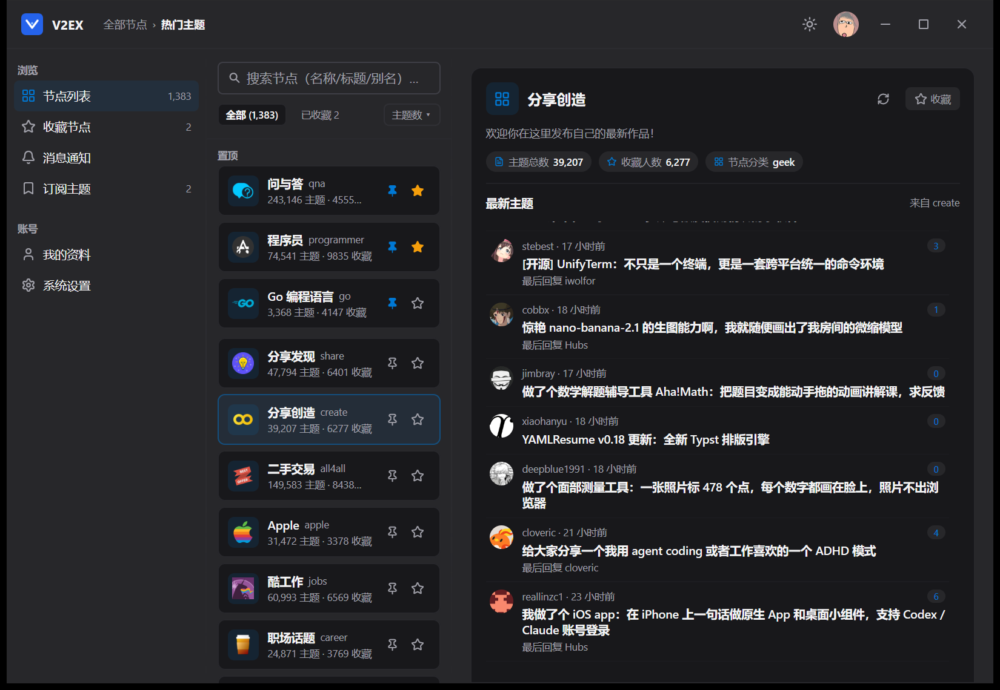
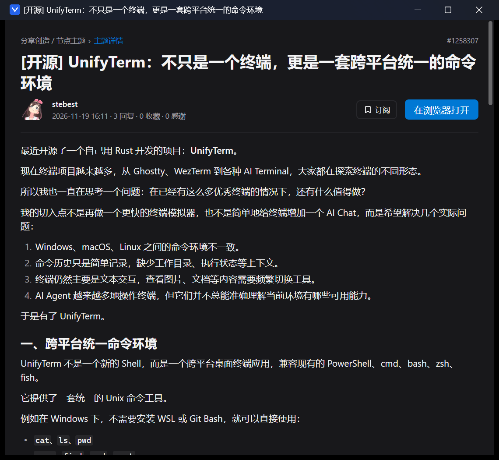

# V2EX Desktop

一个面向 Windows 的 V2EX 桌面客户端，使用 Go + [MyGo](https://github.com/egoist/mygo) 原生 UI 编写。绿色版，无需安装，支持深色/浅色外观。

[](https://github.com/pdxrlj/v2ex_mygo/releases/latest)

## 界面

| 主界面 | 主题详情 |
| --- | --- |
|  |  |

## 功能

- 浏览全站节点，搜索、置顶、拖动排序、收藏节点
- 查看节点最新主题，滚动自动加载下一页
- 独立窗口阅读主题正文与全部回复，支持图片显示、`@` 回复分组
- 主题窗口左右两栏可拖动中间分隔线调整宽度，比例会记住
- 网页登录后可在主题页左下角直接发表评论
- 消息通知：V2EX 站内提醒（回复你、@ 你、感谢你等），带未读角标
- 订阅主题：最多 5 个，有新回复时右下角弹窗提醒
- 网页登录后可签到、查看金币余额，并支持每日自动签到
- 系统托盘：关闭主窗口后继续在后台运行
- 深色/浅色外观、代理设置、本地缓存

## 下载与运行

1. 打开 [Releases](https://github.com/pdxrlj/v2ex_mygo/releases/latest)，下载最新的 `v2ex_mygo.exe`（Windows 10/11 x64）。
2. 在 [V2EX → 设置 → Token](https://v2ex.com/settings/tokens) 创建一个 Personal Access Token。
3. 配置 Token，任选一种：
   - 在 exe 同目录新建 `.env`：

     ```ini
     V2EX_TOKEN=你的令牌
     ```

   - 设置系统环境变量 `V2EX_TOKEN`
   - 启动后在「系统设置 → Personal Access Token」中粘贴并点「应用」
4. 配置代理：默认使用 `http://127.0.0.1:7890`，可在「系统设置 → 代理地址」中修改；留空表示直连。
5. 双击 `v2ex_mygo.exe` 运行。

> 网页登录/签到功能需要系统安装 WebView2 Runtime；正常安装过 Edge 的 Windows 10/11 一般已自带。

## 使用说明

### 消息通知与订阅通知

| 类型 | 内容 | 入口 |
| --- | --- | --- |
| 消息通知 | V2EX 站内提醒：有人回复你、@ 你、感谢你等 | 侧边栏「消息通知」 |
| 订阅通知 | 你订阅的主题出现了新回复 | 侧边栏「订阅主题」→「查看订阅通知」 |

消息通知的自动刷新可以在「系统设置 → 定时刷新通知」中开关，并调整刷新间隔。

### 订阅主题

1. 打开任意主题，点右上角「在浏览器打开」左边的「订阅」
2. 最多同时订阅 5 个主题，第 6 个会提示先取消一个
3. 后台默认每 30 分钟检查一次，可在设置中改为 5 / 10 / 15 / 30 / 60 分钟
4. 有新回复时，屏幕右下角弹出通知卡片：
   - 「查看详情」打开主题
   - 「去除通知」关闭弹窗
   - 12 秒后自动消失
5. 在侧边栏「订阅主题」中可查看全部订阅、打开主题或取消订阅

订阅检查只在应用运行时进行。

### 回复主题

1. 先在「系统设置 → V2EX 网页登录」完成登录
2. 打开主题，在左下角输入框里写内容，点「发表评论」
3. 成功后右侧回复列表会自动刷新；失败原因会显示在输入框下方

> V2EX 的评论不支持 Markdown，换行、链接、`@` 和图片链接会正常显示；主题正文才支持 Markdown。

### 网页登录、签到与余额

1. 进入「系统设置 → V2EX 网页登录」，点「网页登录」
2. 在窗口内完成账号密码和验证码登录，成功后窗口自动关闭
3. 回到设置页即可「签到」「刷新余额」
4. 需要每天自动领取奖励时，打开「每日自动签到」

登录 Cookie 使用 Windows DPAPI 加密后保存在本机，只有当前 Windows 用户能解密。网页登录与 Token 是两套独立的登录方式，余额来自网页登录的账号。

### 系统托盘

关闭主窗口会隐藏到托盘，应用继续在后台检查订阅和通知：

- 左键点击托盘图标：恢复主窗口
- 右键菜单：显示主窗口 / 订阅通知 / 订阅主题 / 系统设置 / 退出 V2EX
- 彻底退出请使用托盘菜单的「退出 V2EX」

## 注意事项

- 回复主题需要先完成网页登录；V2EX API 2.0 的回复接口仅对 PRO 开放，应用通过网页登录态提交
- 请遵守 V2EX 社区规则，不要频繁回复
- 消息通知、订阅检查、自动签到都要求应用保持运行
- V2EX API 默认限制为每个 IP 每小时 600 次请求，默认设置远低于该额度
- 网页登录 Cookie 等同于账号登录凭证，请不要把本机数据库文件交给他人
- 自动签到属于网页自动化操作，请自行评估账号风险
- 订阅通知的右下角弹窗是应用内提示，不会进入 Windows 通知中心
- 本程序与 V2EX 官方无关
