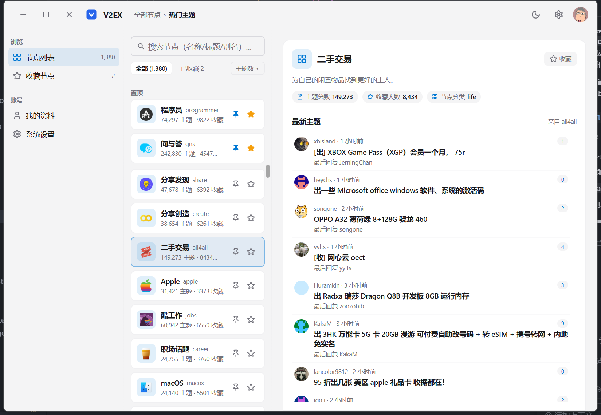
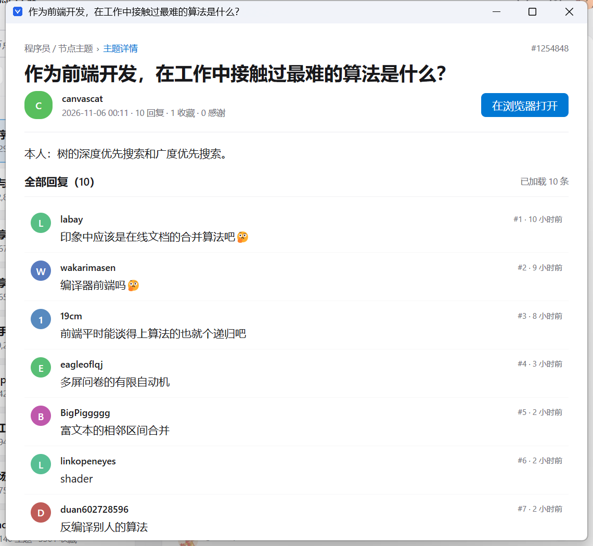
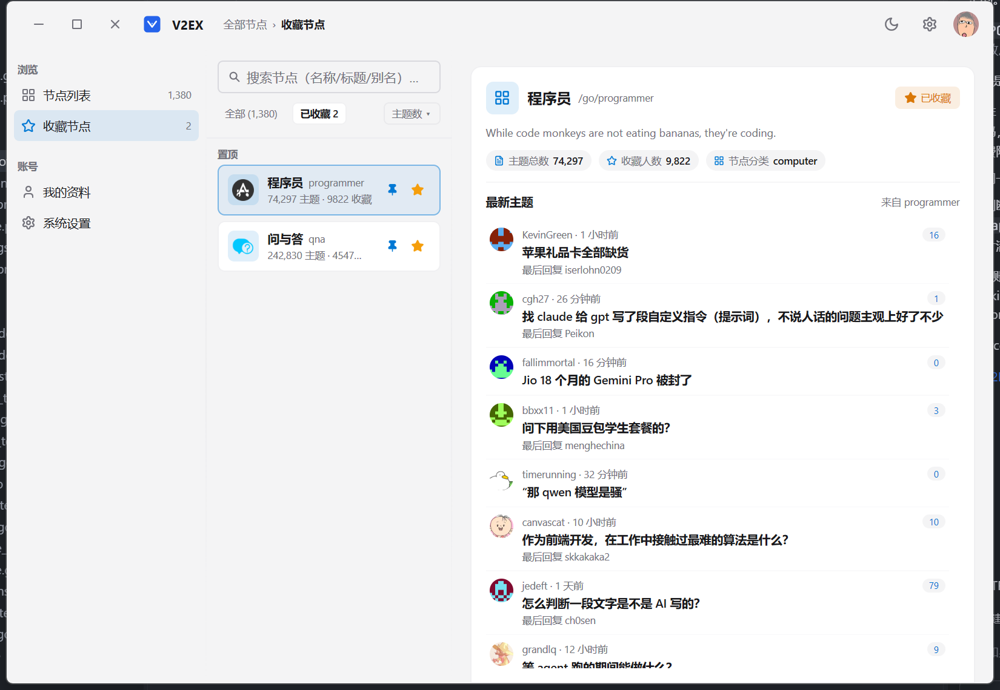
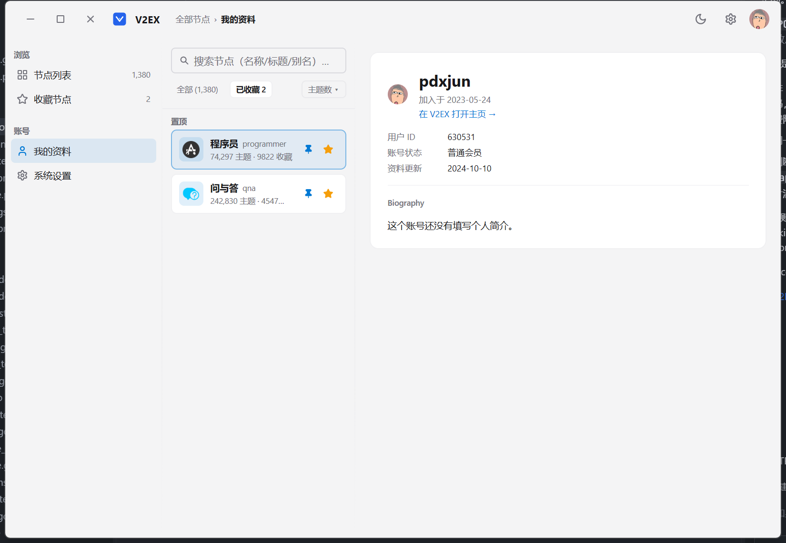
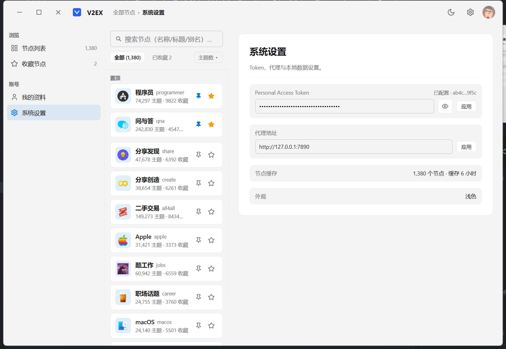
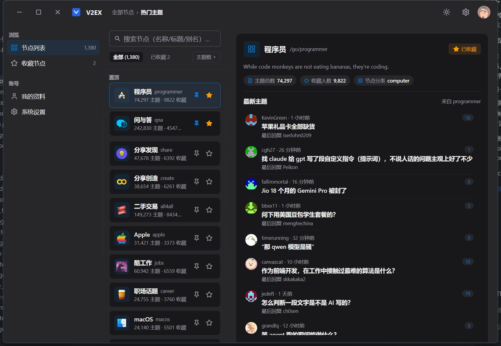

# V2EX Desktop

一个使用 Go + [MyGo](https://github.com/egoist/mygo) 原生 UI 编写的 V2EX 桌面客户端，面向 Windows。

[](https://github.com/pdxrlj/v2ex_mygo/releases/latest)

## 界面

| 主界面 | 主题详情 |
| --- | --- |
|  |  |
| **收藏节点** | **个人资料** |
|  |  |
| **系统设置** | **深色模式** |
|  |  |

## 功能

- **节点列表**：全站节点、搜索（名称 / 标题 / 别名）、按主题数排序
- **置顶与排序**：置顶常用节点，拖动调整节点顺序，布局保存在本地
- **收藏节点**：收藏 / 取消收藏，侧边栏「收藏」视图只显示收藏的节点
- **最新主题**：选中节点后展示最新主题、发帖人、回复数与最后回复，滚动到底自动加载下一页
- **主题详情**：独立窗口阅读主题正文与全部回复，自动加载后续分页
- **回复楼层**：按 `@` 提及关系把回复归组、缩进，长主题也能顺着对话读
- **个人资料**：查看当前 Token 对应账号的资料，网页链接可直接用浏览器打开
- **系统设置**：Token 状态、代理地址在线修改、节点缓存信息、深浅色外观切换
- **本地存储**：使用 SQLite 保存收藏、设置与节点布局；节点列表带本地缓存

## 下载使用

1. 打开 [Releases](https://github.com/pdxrlj/v2ex_mygo/releases/latest) 下载最新的 `v2ex_mygo.exe`（Windows 10/11 x64，绿色版，无需安装）。
2. 在 [V2EX → 设置 → Token](https://v2ex.com/settings/tokens) 创建一个 Personal Access Token。
3. 首次运行前，在 `v2ex_mygo.exe` 同目录新建 `.env` 文件：

   ```ini
   V2EX_TOKEN=你的令牌
   ```

   也可以直接设置同名的系统环境变量，环境变量优先于 `.env`。
4. 双击运行。之后可以在「系统设置 → Personal Access Token」中修改令牌，点击「应用」后会保存到本地数据库，下次启动优先使用保存的值。
5. 程序默认使用本地代理 `http://127.0.0.1:7890`，可在「系统设置 → 代理地址」中修改；留空表示直连。也支持 `HTTPS_PROXY` / `HTTP_PROXY` 环境变量。

> 客户端目前只做浏览，不包含发帖和回复功能（V2EX 的创建回复 API 仅对 PRO 会员开放）。

## 本地开发

需要 Go 1.27 或更高版本。

```sh
make run     # 等同于 go run main.go
make build   # 生成 bin/v2ex_mygo.exe
```

也可以直接使用 Go 命令：

```sh
go build -o bin/v2ex_mygo.exe .
```

## 发布

推送 `v*` 标签会触发 [Release 工作流](.github/workflows/release.yml)，自动编译 Windows 可执行文件并上传到 GitHub Release：

```sh
git tag v1.0.0
git push origin v1.0.0
```

也可以在 Actions 页面手动运行该工作流，填入要发布的版本标签（例如 `v1.0.0`）。

## 技术栈

- [Go](https://go.dev/) + [MyGo](https://github.com/egoist/mygo) 原生桌面 UI
- [resty](https://github.com/go-resty/resty) 调用 V2EX API 2.0
- [modernc.org/sqlite](https://modernc.org/sqlite) 纯 Go 的 SQLite 驱动
- [godotenv](https://github.com/joho/godotenv) 读取 `.env`

## 说明

- 所有数据来自 V2EX 官方 API，Token 只保存在本地的 `.env` 或环境变量中。
- 节点缓存默认保留 6 小时，可在「系统设置」中查看缓存概况。
